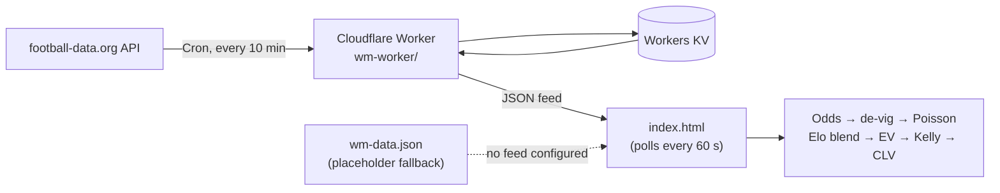

<div align="center">

# 🏆 World Cup 2026 Prediction Assistant

**A multilingual World Cup 2026 forecasting tool: bookmaker odds, an independent Elo model, fractional-Kelly sizing and Closing Line Value tracking.**

[](https://developer.mozilla.org/docs/Web/JavaScript)
[](index.html)
[](https://workers.cloudflare.com)
[](https://www.football-data.org)
[](#-features)

📄 **[Methodology & scientific basis](METHODOLOGY.md)**

</div>

> **18+ · Educational / analytical project. Not financial advice.** This tool is built to
> *measure* edge honestly, not to promise profit. Betting against efficient bookmaker
> markets is hard and most bettors lose. The science here is about knowing whether an edge
> actually exists. Paper trading uses fictional money only.

## About

A free, multilingual World Cup 2026 prediction tool that applies **probability theory and
quantitative sports-betting research** to real bookmaker odds. It produces scoreline
forecasts, an independent **Elo value model**, fractional-Kelly staking, a dynamic strategy
comparison and, as the methodological centrepiece, **Closing Line Value (CLV) tracking**:
the literature-backed way to measure whether a betting edge is real. The whole engine runs
client-side in a single HTML file, with an optional serverless feed for live scores.

## 🔬 Why this is more than a betting app

This is a small **applied-statistics project** that implements, end to end, the standard
academic pipeline for quantitative betting:

| Stage | Method | Grounded in |
|---|---|---|
| Market → probabilities | De-vigging + bivariate **Poisson** goal model | Maher (1982); Dixon & Coles (1997) |
| Independent signal | **Elo** ratings → goal supremacy → W/D/L | World Football Elo |
| Combining the two | **Shrinkage** toward the market (efficient prior) | Miller & Davidow (2019) |
| Bet selection | Expected value + edge + long-shot safeguard | — |
| Staking | **Fractional Kelly** | Kelly (1956); Thorp; MacLean/Thorp/Ziemba |
| Validation | **Closing Line Value (CLV)** | Miller & Davidow; Buchdahl |

Every parameter (`BLEND_W = 0.30`, `EDGE_MIN = 0.04`, `MIN_PROB = 0.20`, …) is justified in
[`METHODOLOGY.md`](METHODOLOGY.md), including the honest limitations: main markets are
roughly `R² = 0.997` efficient and realistic ROI is low single digits at best.

## ✨ Features

- **Match predictions**: most likely scoreline per match (odds → Poisson), suited to prediction pools like Kicktipp.
- **Live results**: connects to a data feed and shows real LIVE / FT scores next to each prediction (polled every 60 s).
- **Value engine**: independent Elo model blended toward the market; flags only positive-EV bets, with a 20% minimum-probability filter to skip unreliable long-shots.
- **Strategy comparison**: enter a total stake and see it distributed across value bets at three risk levels (Safe / Balanced / Higher reward).
- **Paper trading + CLV**: logs bets with fictional money (persisted in `localStorage`), settles automatically on real results, and tracks **Closing Line Value**.
- **10 languages**: English (default), Español, Français, Português, Deutsch, Nederlands, Türkçe, العربية (RTL), 日本語, 한국어.

## 🧱 Tech stack

- **Frontend:** a single self-contained `index.html`. Vanilla JavaScript, no framework, no external scripts, no build step. All Poisson / Elo / Kelly / CLV maths runs client-side.
- **Backend (optional):** a **Cloudflare Worker** (`wm-worker/`) on a Cron Trigger pulls real fixtures and live/final scores from the free [football-data.org](https://www.football-data.org/) API and caches them in **Workers KV**.
- **i18n:** a lightweight custom dictionary system with full RTL support for Arabic.

## 🏗️ How it works



The free data tier provides fixtures, match status and scores, **not** betting odds; the page
keeps its configured odds for the model and shows the real result next to each prediction.

## 🚀 Getting started

**Run locally:** open `index.html` in a browser. That's it.

**Enable the live feed (optional):** deploy the worker by following
[`wm-worker/README.md`](wm-worker/README.md). In short:

```bash
cd wm-worker
npm install -g wrangler
wrangler login
wrangler kv namespace create WMKV        # paste the id into wrangler.toml
wrangler secret put FOOTBALL_DATA_KEY    # your football-data.org token
wrangler deploy
```

Open `<worker-url>/refresh` once to populate the cache, then point the page at the worker by adding
this before the main script in `index.html`:

```html
<script>window.WM_FEED_URL = "https://your-worker.workers.dev";</script>
```

Without it, the page reads the bundled `wm-data.json` placeholder.

**Host it:** because it is a single static file, it can be served from GitHub Pages or any static host.

## 📁 Project structure

```
index.html            the complete app (UI, i18n, prediction engine)
METHODOLOGY.md        statistical methods, parameters and references
wm-data.json          placeholder feed (fixtures without scores)
wm-worker/
  src/worker.js       Cloudflare Worker: cron fetch → KV → JSON endpoint (+ /refresh)
  wrangler.toml       Worker config (cron schedule, KV binding)
  README.md           step-by-step deployment guide
```

## 📚 References

Kelly (1956) · Thorp · MacLean/Thorp/Ziemba · Maher (1982) · Dixon & Coles (1997) ·
Constantinou & Fenton (2013) · Miller & Davidow (2019) · Buchdahl. Full list in
[`METHODOLOGY.md`](METHODOLOGY.md).

## ⚠️ Disclaimer

For educational and analytical purposes only, 18+. Nothing here is financial or betting advice,
and no warranty is given. Gambling involves risk of loss; if you choose to bet, follow your local
laws and only stake what you can afford to lose.

---

<div align="center">

Built by [Christoph Barton](https://christophbarton.com)

</div>
